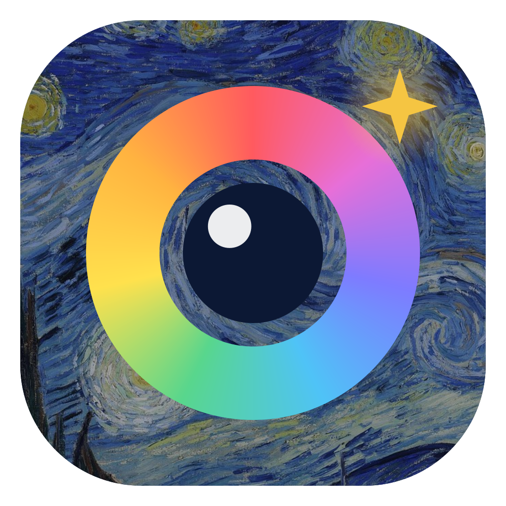
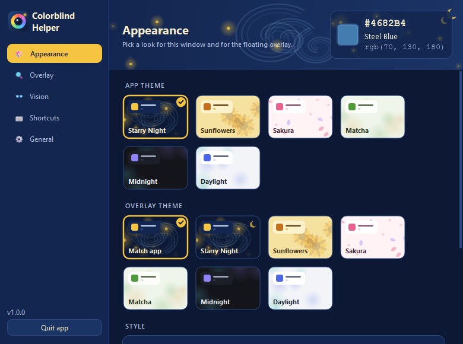
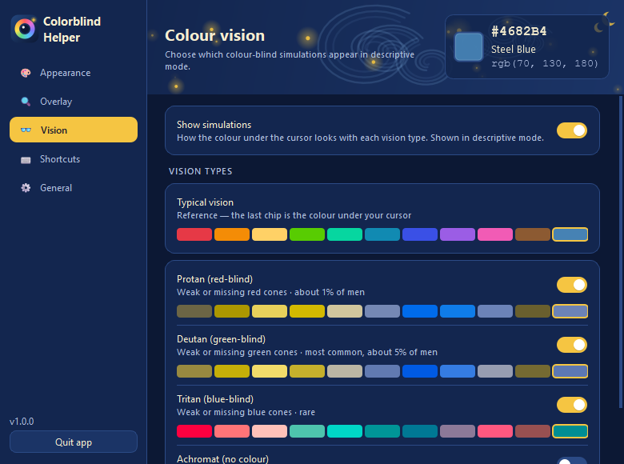
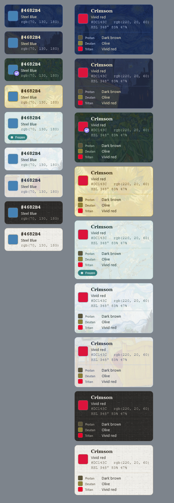
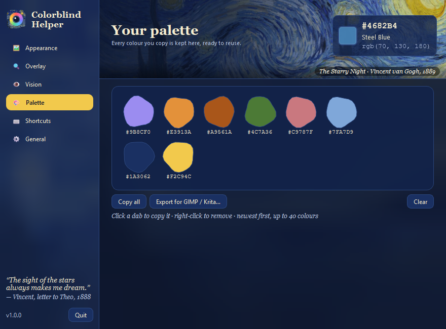
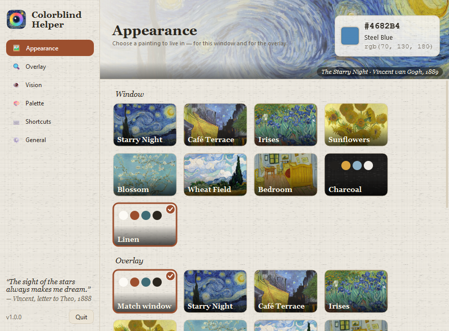

<p align="center">
  
</p>

<h1 align="center">Colorblind Helper: color picker &amp; color name overlay for color blind people</h1>

<p align="center">
  <i>For colour-blind artists, with love from Vincent's palette.</i><br>
  A free, open-source <b>color identifier</b> that <b>names the color under your mouse cursor</b>.
  It also simulates <b>protanopia, deuteranopia and tritanopia</b>. Windows &amp; macOS.
</p>

<p align="center">
  <a href="https://github.com/xilla420/ColorblindHelper/releases/latest"></a>
  <a href="https://github.com/xilla420/ColorblindHelper/releases"></a>
  
  <a href="LICENSE"></a>
  <a href="https://github.com/xilla420/ColorblindHelper/stargazers"></a>
</p>

<p align="center">
  <a href="https://github.com/xilla420/ColorblindHelper/releases/latest/download/ColorblindHelper-Windows.exe"><b>⬇ Windows</b></a> ·
  <a href="https://github.com/xilla420/ColorblindHelper/releases/latest/download/ColorblindHelper-macOS.zip"><b>⬇ macOS</b></a> ·
  <a href="https://xilla420.github.io/ColorblindHelper/"><b>Website</b></a>
</p>

> About 1 in 12 men and 1 in 200 women have some form of color blindness (color vision deficiency).
> Colorblind Helper sits in your tray and labels colors anywhere on screen: in web pages, photos, charts,
> games, design tools and digital paintings.

<p align="center">
  
  
</p>

## What it does

- **Names every colour you point at:** HEX, RGB and the closest named colour (CIEDE2000).
- **Descriptive mode:** gives the full story of a colour in plain words (*"Light muted teal"*,
  *"Dark brown"*), plus HSL, HSV, CMYK and contrast ratios.
- **Through other eyes:** shows how the colour reads for **protan, deutan, tritan and
  achromat** vision, in any combination you choose. The Vision page also shows Vincent's 1887
  self-portrait (a red beard against a green ground) through each kind of colour vision.
- **Your palette:** every colour you copy is kept as a paint dab. Click a dab to copy it again,
  or export the whole palette as a `.gpl` file for GIMP, Krita or Inkscape.
- **Live in a painting:** themes come from *The Starry Night*, *Café Terrace at Night*,
  *Irises*, *Sunflowers*, *Almond Blossom*, *Wheat Field with Cypresses* and *The Bedroom*.
  There are also two plain studio themes, *Charcoal* and *Linen*.
  - Each palette is sampled from the canvas itself.
  - The banner shows the painting drifting slowly, with a museum-style caption.
  - The studio themes show the paintings in turn.
- **Follows your brush:** the overlay sticks to the cursor and lets clicks pass through it.
  You can also detach it and park it anywhere.
- **Customise it:** set opacity, size, swatch size, corner roundness and font, choose which fields
  to show, sample 1×1, 3×3 or 5×5 pixels, and set hotkeys by pressing the keys.
- Run at startup (off by default), lives in the tray, runs only one copy at a time, and uses
  about 1% of one CPU core while idle.

<p align="center">
  
</p>

<p align="center">
  
  
</p>

## Install

**Windows:** download `ColorblindHelper-Windows.exe` from
[Releases](https://github.com/xilla420/ColorblindHelper/releases/latest) and run it.
There is no installer. SmartScreen may warn you because the exe is unsigned: choose
*More info → Run anyway*.

**macOS:** download `ColorblindHelper-macOS.zip`, unzip it and move the app to Applications.
The app is unsigned, so the first time you open it, right-click it and choose *Open*. Then allow
**Screen Recording** (and **Accessibility** if you want global hotkeys) in
*System Settings → Privacy & Security*, and restart the app.

**From source** (Python 3.10 or newer):

```bash
pip install -r requirements.txt
python main.py
```

## Using it

| Action                         | Global hotkey | Overlay focused  |
|--------------------------------|---------------|------------------|
| Copy HEX (and add to palette)  | Ctrl+Shift+C  | C                |
| Freeze / unfreeze              | Ctrl+Shift+F  | Space            |
| Follow cursor on / off         | Ctrl+Shift+A  | A                |
| Descriptive mode on / off      | Ctrl+Shift+D  | D / double-click |
| Show / hide overlay            | Ctrl+Shift+H  | Esc (hide)       |

You can also right-click the tray icon or the overlay for the menu. Double-click the tray icon to open settings.

## FAQ

**How can a color blind person tell what color something is on screen?**
Run Colorblind Helper and move your mouse over it. The overlay shows the color's name (for example *Crimson*), a
plain-language description (*Vivid red*), and its HEX and RGB values.

**Which kinds of color blindness does it cover?**
It covers protanopia/protanomaly (red), deuteranopia/deuteranomaly (green, the most common), tritanopia (blue) and
achromatopsia (no color). The simulations use the Machado et al. (2009) model.

**Can I use it as an eyedropper or screen color picker?**
Yes. Freeze the color with Space or Ctrl+Shift+F, then copy the HEX or RGB value. Copied colors are kept in your
palette.

**Is it useful for designers checking accessibility?**
Yes. Descriptive mode shows WCAG contrast ratios against white and black, and the simulations show which
colors would be confused.

**Does it collect data?**
No. It runs entirely offline, with no account and no telemetry.

## Alternatives & related

You might also know tools such as Color Oracle (a full-screen color blindness simulator), Sim Daltonism (macOS) and
the eyedroppers built into design apps. Colorblind Helper is different because it's a **follow-the-cursor
color name overlay** that combines identification, simulation and an artist's palette in one small app.

## The paintings

All the paintings are by Vincent van Gogh (1853–1890) and are in the public domain. The scans come from
Wikimedia Commons:

| Painting | Year | Collection |
|---|---|---|
| [The Starry Night](https://commons.wikimedia.org/wiki/File:Van_Gogh_-_Starry_Night_-_Google_Art_Project.jpg) | 1889 | Museum of Modern Art, New York |
| [Café Terrace at Night](https://commons.wikimedia.org/wiki/File:Vincent_Willem_van_Gogh_-_Cafe_Terrace_at_Night_(Yorck).jpg) | 1888 | Kröller-Müller Museum, Otterlo |
| [Irises](https://commons.wikimedia.org/wiki/File:Irises-Vincent_van_Gogh.jpg) | 1889 | J. Paul Getty Museum, Los Angeles |
| [Sunflowers](https://commons.wikimedia.org/wiki/File:Vincent_Willem_van_Gogh_127.jpg) | 1888 | National Gallery, London |
| [Almond Blossom](https://commons.wikimedia.org/wiki/File:Vincent_van_Gogh_-_Almond_blossom_-_Google_Art_Project.jpg) | 1890 | Van Gogh Museum, Amsterdam |
| [Wheat Field with Cypresses](https://commons.wikimedia.org/wiki/File:Vincent_van_Gogh_-_Wheat_Field_with_Cypresses_-_Google_Art_Project.jpg) | 1889 | Metropolitan Museum of Art, New York |
| [The Bedroom](https://commons.wikimedia.org/wiki/File:Vincent_van_Gogh_-_De_slaapkamer_-_Google_Art_Project.jpg) | 1888 | Van Gogh Museum, Amsterdam |
| [Self-Portrait](https://commons.wikimedia.org/wiki/File:Vincent_van_Gogh_-_Self-Portrait_-_Google_Art_Project_(454045).jpg) | 1887 | Art Institute of Chicago |

The quotes in the sidebar come from Vincent's letters to his brother Theo.

## Build

```bash
pip install -r requirements.txt pyinstaller pillow
python tools/make_icons.py
python -m PyInstaller --noconfirm ColorblindHelper.spec
```

This produces `dist/ColorblindHelper.exe` on Windows and `dist/ColorblindHelper.app` on macOS. Publishing a GitHub
release also builds both automatically ([workflow](.github/workflows/release.yml)).
`tools/prepare_paintings.py` turns the full-size scans into the bundled 1400 px JPEGs.

## Project layout

```
colorblind_helper/
  app.py              tray, menus, hotkeys, single instance, palette, wiring
  overlay.py          overlay window + renderer (shared with the live preview)
  settings_window.py  the settings window
  widgets.py          gallery banner, theme cards, toggles, palette dabs, hotkey recorder
  paintings.py        painting metadata, crops, blur, colour-vision image simulation
  themes.py           painting-derived themes, typography, canvas texture, stylesheets
  colors.py           conversions, naming, descriptions, CVD simulation
  pixel.py            screen sampling (GDI on Windows, Qt elsewhere)
  autostart.py        run at login (registry / LaunchAgent / XDG)
  settings.py         persisted settings
  hotkeys.py          global hotkeys (pynput)
  icon.py             app icon (a Starry Night crop with a colour-wheel iris)
```

Colour-vision simulation uses the Machado, Oliveira &amp; Fernandes (2009) model.

## License

The code is MIT licensed. The paintings are in the public domain.
