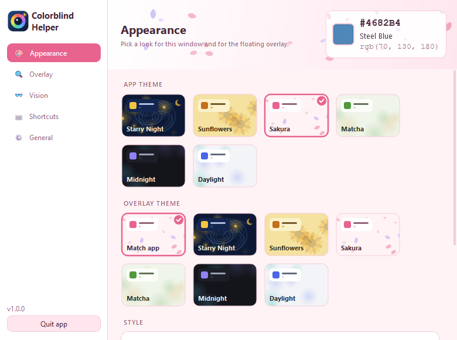

<p align="center">
  
</p>

<h1 align="center">Colorblind Helper</h1>

<p align="center">
  A tiny always-on-top overlay that <b>names the colour under your cursor</b>.<br>
  Built for colour-blind folks. Windows &amp; macOS.
</p>

<p align="center">
  <a href="https://github.com/xilla420/ColorblindHelper/releases/latest"><b>⬇ Download the latest release</b></a>
</p>

<p align="center">
  
  
</p>

## Features

- **Live colour under the cursor:** HEX, RGB and the closest named colour (CIEDE2000 matching).
- **Descriptive mode:** plain-language names like *"Light muted teal"*, *"Dark brown"* or
  *"Pale pink"*, plus HSL, HSV, CMYK and contrast ratios.
- **Colour-vision simulations:** pick any mix of **protan, deutan, tritan and achromat**
  to see how the colour looks with each one. You can toggle them from the menu without it closing.
- **Follows your cursor** (click-through), or **detach it** and drag it anywhere.
- **Themes:** *Starry Night* and *Sunflowers* (Van Gogh), *Sakura*, *Matcha*, *Midnight*,
  *Daylight*. The settings window and the overlay can each have their own theme, and
  both come with gentle animated decorations.
- **Customise everything:** opacity, size, swatch, roundness, font, which fields show,
  1×1 / 3×3 / 5×5 sampling, refresh rate.
- **Global hotkeys** that you set by pressing the keys.
- **Run at startup** (off by default), single instance, tray / menu-bar app.
- Light on resources: about 1% of one CPU core while idle.

<p align="center">
  
</p>

## Install

**Windows:** download `ColorblindHelper-Windows.exe` from
[Releases](https://github.com/xilla420/ColorblindHelper/releases/latest) and run it.
There is no installer. SmartScreen may warn you because the exe is unsigned: choose
*More info → Run anyway*.

**macOS:** download `ColorblindHelper-macOS.zip`, unzip it, and move the app to
Applications. The app is unsigned, so the first time you open it, right-click it and choose *Open*. Then allow
**Screen Recording** (and **Accessibility** if you want global hotkeys) in
*System Settings → Privacy & Security*, and restart the app.

**From source** (any OS, Python 3.10+):

```bash
pip install -r requirements.txt
python main.py
```

## Using it

| Action                     | Global hotkey | Overlay focused |
|----------------------------|---------------|-----------------|
| Copy HEX                   | Ctrl+Shift+C  | C               |
| Freeze / unfreeze          | Ctrl+Shift+F  | Space           |
| Follow cursor on / off     | Ctrl+Shift+A  | A               |
| Descriptive mode on / off  | Ctrl+Shift+D  | D / double-click|
| Show / hide overlay        | Ctrl+Shift+H  | Esc (hide)      |

You can also right-click the tray icon or the overlay for the menu. Scroll over a detached overlay to
resize it. Double-click the tray icon to open settings.

<p align="center"></p>

## Build

```bash
pip install -r requirements.txt pyinstaller pillow
python tools/make_icons.py
python -m PyInstaller --noconfirm ColorblindHelper.spec
```

This produces `dist/ColorblindHelper.exe` on Windows and `dist/ColorblindHelper.app` on macOS. Publishing a GitHub
release also builds both automatically ([workflow](.github/workflows/release.yml)).

## Project layout

```
colorblind_helper/
  app.py              tray, menus, hotkeys, single instance, wiring
  overlay.py          overlay window + renderer (shared with the live preview)
  settings_window.py  settings UI (sidebar, banner, cards)
  widgets.py          toggle switch, theme cards, hotkey recorder, live preview
  themes.py           themes, Qt stylesheets, animated decorations
  colors.py           conversions, naming, descriptions, CVD simulation
  pixel.py            screen sampling (GDI on Windows, Qt elsewhere)
  autostart.py        run at login (registry / LaunchAgent / XDG)
  settings.py         persisted settings
  hotkeys.py          global hotkeys (pynput)
  icon.py             app icon, drawn in code
```

Colour-vision simulation uses the Machado, Oliveira &amp; Fernandes (2009) model.

## License

MIT
